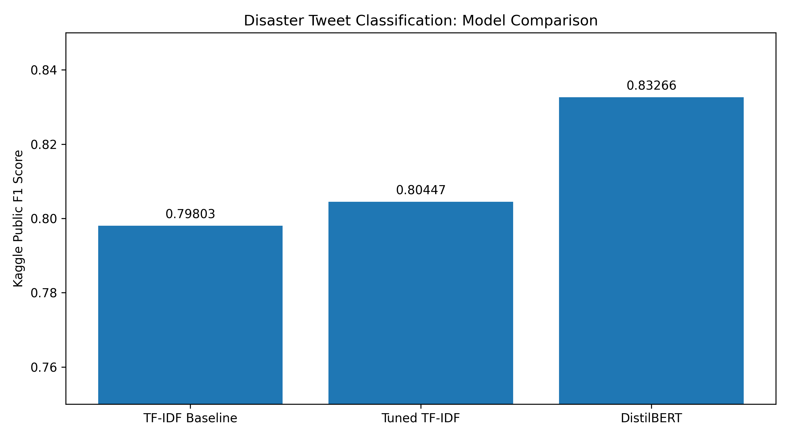
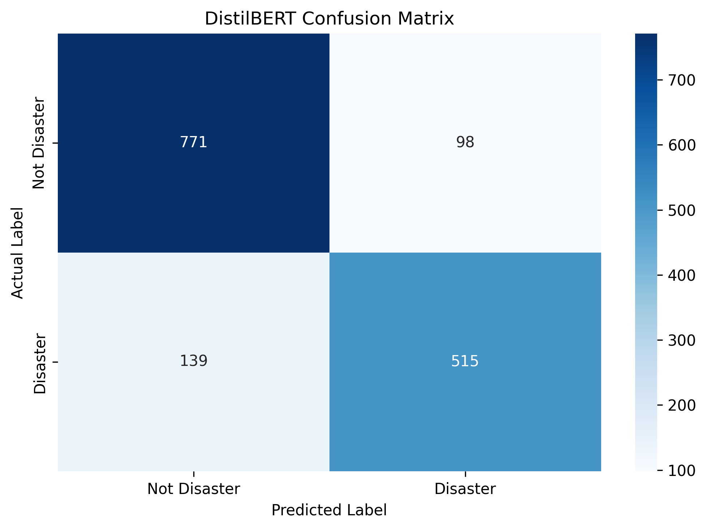

# Disaster Tweet Classification using NLP and Deep Learning

## Project Overview

This project classifies tweets into two categories:

- **Disaster (1):** Tweets referring to real disaster events.
- **Not Disaster (0):** Tweets that do not refer to real disaster events.

The project compares a traditional machine learning approach using TF-IDF and Logistic Regression with a transformer-based approach using DistilBERT.

## Models Implemented

### 1. TF-IDF + Logistic Regression

- Converts text into numerical features using Term Frequency–Inverse Document Frequency (TF-IDF).
- Uses word unigrams and bigrams.
- Trains a Logistic Regression classifier.
- Serves as a computationally efficient and interpretable baseline.

### 2. DistilBERT

- Uses the pretrained `distilbert/distilbert-base-uncased` model.
- Fine-tunes the model for binary tweet classification.
- Uses a maximum sequence length of 128 tokens.
- Trains for three epochs with a learning rate of `2e-5`.
- Evaluates performance using accuracy, precision, recall, and F1 score.

## Experimental Results

| Model | Validation F1 | Kaggle Public Score |
|---|---:|---:|
| TF-IDF + Logistic Regression (baseline) | 0.7701 | 0.79803 |
| Tuned TF-IDF + Logistic Regression | 0.7793 | 0.80447 |
| DistilBERT | 0.8129 | 0.83266 |

## Model Comparison

The following graph compares the public Kaggle F1 scores of the
baseline TF-IDF model, tuned TF-IDF model, and DistilBERT.



**Best model:** DistilBERT, with a Kaggle public score of **0.83266**.

DistilBERT improved the Kaggle score by 0.02819 compared with the best TF-IDF submission.

*Note: Validation metrics and Kaggle public scores come from different evaluation sets and should be interpreted separately.*

## Model Evaluation

### Confusion Matrix

The confusion matrix shows how effectively DistilBERT distinguishes real disaster tweets from non-disaster tweets on the validation set.



### Classification Report

The classification report evaluates the model using precision, recall, and F1 score for both classes.

The model achieved a validation F1 score of **0.8129** and a Kaggle public score of **0.83266**.

The validation results are used to assess model performance before submission, while the Kaggle score measures performance on the competition's evaluation data.

## Technologies Used

- Python
- Pandas and NumPy
- Scikit-learn
- Hugging Face Transformers and Datasets
- PyTorch
- Google Colab
- Kaggle

## Repository Structure

```text
Disaster-Tweet-Classification/
├── data/
├── images/
├── models/
├── notebooks/
│   └── bert_implementation.ipynb
├── outputs/
├── src/
├── .gitignore
├── README.md
└── requirments.txt
```

The repository may contain additional notebooks and source files as the project develops.

## How to Run

1. Open the notebook in `notebooks/`.
2. Install the required Python libraries.
3. Load the Kaggle competition datasets.
4. Run the notebook cells in order.
5. Evaluate the model on the validation split.
6. Generate a submission CSV for Kaggle.

## Dataset

The project uses the [Natural Language Processing with Disaster Tweets](https://www.kaggle.com/competitions/nlp-getting-started) competition dataset.

The training dataset contains labeled tweets, while the test dataset is used to generate predictions for submission.

## Key Learning Outcomes

- Text preprocessing and feature extraction.
- TF-IDF vectorization and Logistic Regression.
- Transformer-based text classification.
- Fine-tuning a pretrained language model.
- Evaluating classification models using F1 score.
- Comparing traditional machine learning with deep learning.

## Future Improvements

- Experiment with different learning rates and epoch counts.
- Analyze misclassified tweets using a confusion matrix.
- Compare DistilBERT with other transformer models.
- Improve reproducibility and document the experimental setup.
